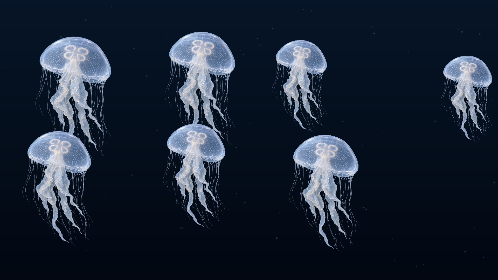
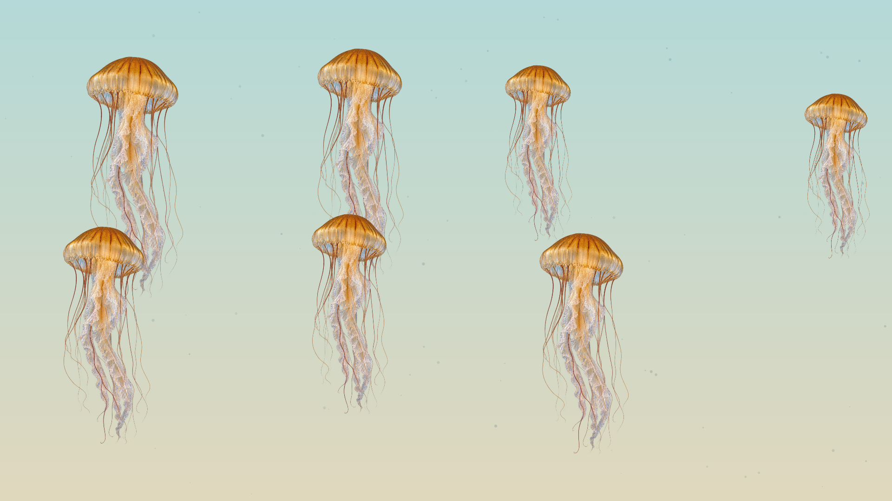
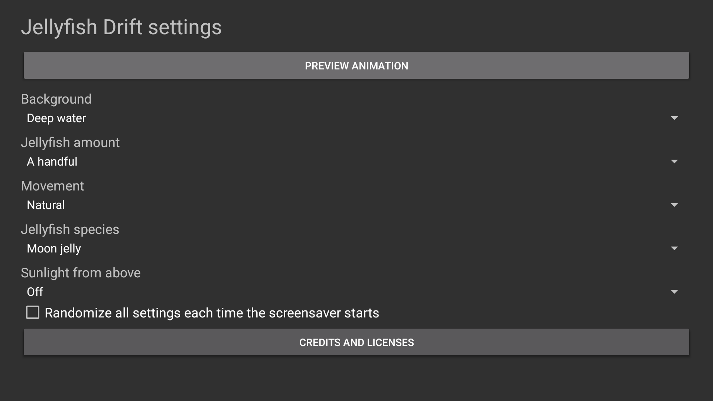

<p align="center">
  <a href="https://github.com/jeremykenedy/jellyfish-drift#gh-light-mode-only"><picture><source media="(max-width: 600px) and (prefers-reduced-motion: reduce)" srcset="art/banner-mobile-still-light.ead673b17b6a.svg"><source media="(prefers-reduced-motion: reduce)" srcset="art/banner-still-light.53b8b6ea20a2.svg"><source media="(max-width: 600px)" srcset="art/banner-mobile-light.aade8a353cc6.svg"></picture></a>
  <a href="https://github.com/jeremykenedy/jellyfish-drift#gh-dark-mode-only"><picture><source media="(max-width: 600px) and (prefers-reduced-motion: reduce)" srcset="art/banner-mobile-still-dark.93739e324fc0.svg"><source media="(prefers-reduced-motion: reduce)" srcset="art/banner-still-dark.03ea33107cec.svg"><source media="(max-width: 600px)" srcset="art/banner-mobile-dark.3ff6403710eb.svg"></picture></a>
</p>

<p align="center">The original illustrated jellyfish screensaver, with dark and light water and adjustable movement.</p>

<p align="center">
  <a href="https://github.com/jeremykenedy/jellyfish-drift/releases"></a>
  <a href="https://github.com/jeremykenedy/jellyfish-drift/releases"></a>
  <a href="https://github.com/jeremykenedy/jellyfish-drift/actions/workflows/ci.yml"></a>
  <a href="https://github.com/jeremykenedy/jellyfish-drift/actions/workflows/style.yml"></a>
  <a href="https://github.com/jeremykenedy/jellyfish-drift/actions/workflows/docs.yml"></a>
  <a href="https://github.com/jeremykenedy/jellyfish-drift/actions/workflows/security.yml"></a>
  <a href="LICENSE"></a>
</p>
<p align="center">
  <a href="https://github.com/jeremykenedy"></a>
  <a href="https://github.com/jeremykenedy/jellyfish-drift"></a>
  <a href="https://github.com/sponsors/jeremykenedy"></a>
</p>

Version 3 restores the original public 1.0.0 Canvas scene in the same app package. [Jellyfish Drift V2](https://github.com/jeremykenedy/jellyfish-drift-v2) is the separate filmed app. Both can remain installed, with independent preferences. See the [verification record](docs/VERIFICATION.md).

If you enjoy Jellyfish Drift, show your support by starring the repository.

## Table of contents

- [Privacy](#privacy)
- [Features](#features)
- [Requirements](#requirements)
- [Installation](#installation)
- [Fire TV Toolkit](#fire-tv-toolkit)
- [Configuration](#configuration)
- [Screenshots](#screenshots)
- [Building and testing](#building-and-testing)
- [Documentation](#documentation)
- [License](#license)

## Privacy

The classic scene uses bundled artwork, with no network permission, advertisements, analytics, or tracking. The optional command-line installer contacts GitHub to download published release files and verify their checksum.

## Features

| Feature | What it does | Details |
| --- | --- | --- |
| Classic scene | Original illustrated jellyfish and continuous motion | [Architecture](docs/ARCHITECTURE.md) |
| Water and lighting | Dark or light backgrounds and optional rays | [Configuration](docs/CONFIGURATION.md) |
| Creature controls | Amount, species, movement, and random choices | [Configuration](docs/CONFIGURATION.md) |
| Native settings | Preview and offline licenses, operated on the TV | [Gallery](docs/SCREENSHOTS.md) |
| Independent apps | Classic retains its package; filmed V2 is a separate install | [Upgrade guide](docs/releases/v3.0.0.md) |

## Requirements

- Android 6.0 (API 23) or later on a compatible TV device.
- A system or host application that supports Android DreamService screensavers.
- ADB access from a computer when sideloading.

Physical Google TV support, sustained thermal behavior, and native 4K source detail are not established. See [platform evidence](docs/VERIFICATION.md).

## Installation

For the **published release**, connect the TV with ADB and run:

```bash
python3 install.py --serial TV_IP:5555
```

The installer verifies the downloaded APK against its release checksum and updates the existing package. It does not automatically select a screensaver. See [installation and removal](docs/INSTALLATION.md).

## Fire TV Toolkit

[Fire TV Toolkit](https://github.com/jeremykenedy/fire-tv-toolkit) provides guided TV setup and screensaver management. Set up its CLI first:

```bash
git clone https://github.com/jeremykenedy/fire-tv-toolkit.git
cd fire-tv-toolkit
node setup.js
```

Use these commands for the published Jellyfish Drift release:

```bash
# Install
firetv-screensavers --install=jellyfish-drift --yes
# Select separately
screensaver --set=jellyfish-drift
# Update the installed package
firetv-screensavers --install=jellyfish-drift --yes
# Remove the app and its saved preferences
firetv-screensavers --uninstall=jellyfish-drift --force
```

Toolkit also manages launcher choices, sleep/screensaver timers, and supported settings protection. Installation does not select a screensaver. Configure the classic scene in Jellyfish Drift's native settings; see the [integration contract](docs/INTEGRATION.md).

## Configuration

Open Jellyfish Drift to choose water background, amount, movement, species, lighting, or randomization. All six original settings are effective again. The [configuration guide](docs/CONFIGURATION.md) documents their original values and provider.

## Screenshots

<table>
<tr><td width="33%"><br>Deep water, original moon-jelly artwork</td><td width="33%"><br>Sunlit water, original sea-nettle artwork</td><td width="33%"><br>Six original settings</td></tr>
</table>

Current native emulator captures. See the [full gallery and provenance](docs/SCREENSHOTS.md). Physical device and bound Dream gates for this split package remain pending.

## Building and testing

```bash
bash build.sh
bash test.sh
bash scripts/test-python-coverage.sh
bash scripts/test-coverage.sh
```

The build requires Android SDK platform 36, build-tools 36.0.0, JDK 17 or later, and the original protected signing key. It does not silently generate a replacement production key. See [building](docs/BUILDING.md) and [testing](docs/TESTING.md).

## Documentation

- [Configuration and migration](docs/CONFIGURATION.md)
- [Host integration contract](docs/INTEGRATION.md)
- [Screenshots](docs/SCREENSHOTS.md)
- [Installation, update, and removal](docs/INSTALLATION.md)
- [Building from source](docs/BUILDING.md)
- [Architecture](docs/ARCHITECTURE.md)
- [Testing and coverage](docs/TESTING.md)
- [Device verification](docs/VERIFICATION.md)
- [CI](docs/CI.md)
- [Troubleshooting](docs/TROUBLESHOOTING.md)
- [Release process](docs/RELEASING.md)
- [Version 3.0.0 classic restoration guide](docs/releases/v3.0.0.md)
- [Historical version 2.0.0 filmed release](docs/releases/v2.0.0.md)
- [Historical version 1.0.0 notes](docs/releases/v1.0.0.md)

## License

Application code and original bundled artwork are licensed under the [Apache License, Version 2.0](LICENSE). See [project notices](NOTICE). The same license and notices are available offline in native settings.
