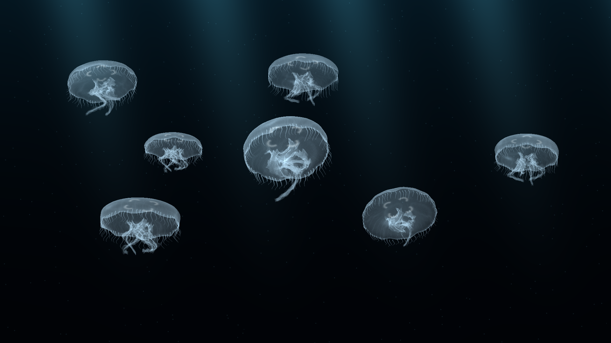
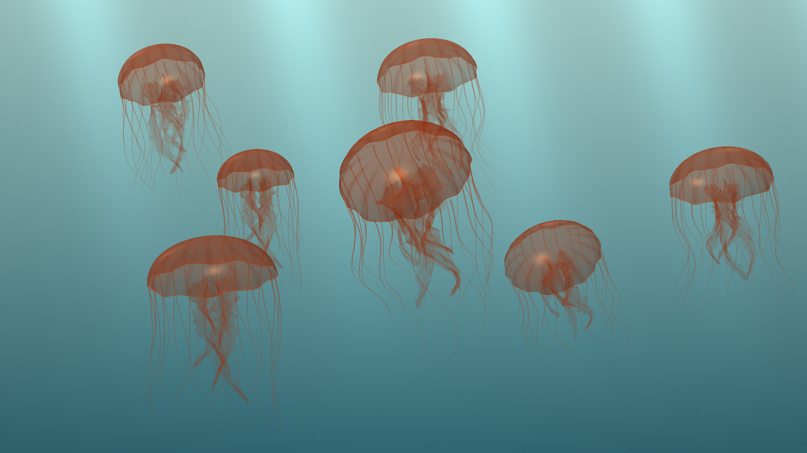
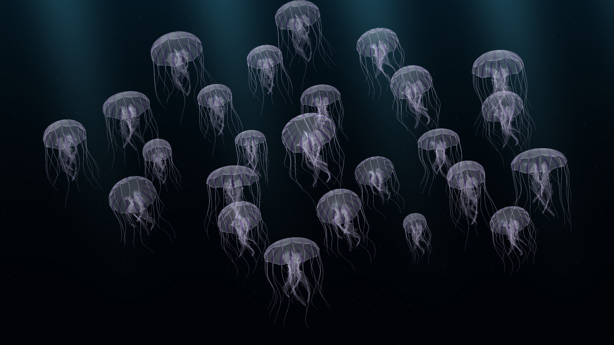

<p align="center">
  <a href="https://github.com/jeremykenedy/jellyfish-drift#gh-light-mode-only"><picture><source media="(max-width: 600px) and (prefers-reduced-motion: reduce)" srcset="art/banner-mobile-still-light.7416bbc15dc3.svg"><source media="(prefers-reduced-motion: reduce)" srcset="art/banner-still-light.9a29f3c07ae6.svg"><source media="(max-width: 600px)" srcset="art/banner-mobile-light.d5e6231d1911.svg"></picture></a>
  <a href="https://github.com/jeremykenedy/jellyfish-drift#gh-dark-mode-only"><picture><source media="(max-width: 600px) and (prefers-reduced-motion: reduce)" srcset="art/banner-mobile-still-dark.2c7dd223a1f9.svg"><source media="(prefers-reduced-motion: reduce)" srcset="art/banner-still-dark.197674a6221c.svg"><source media="(max-width: 600px)" srcset="art/banner-mobile-dark.4d522b681806.svg"></picture></a>
</p>

<p align="center">Curved translucent jellyfish, flowing tentacles and dark or sunlit water for your TV.</p>

<p align="center">
    <a href="https://github.com/jeremykenedy/jellyfish-drift/releases"></a>
    <a href="https://github.com/jeremykenedy/jellyfish-drift/releases"></a>
    <a href="https://github.com/jeremykenedy/jellyfish-drift/actions/workflows/ci.yml"></a>
    <a href="https://github.com/jeremykenedy/jellyfish-drift/actions/workflows/style.yml"></a>
    <a href="https://github.com/jeremykenedy/jellyfish-drift/actions/workflows/docs.yml"></a>
    <a href="https://github.com/jeremykenedy/jellyfish-drift/actions/workflows/security.yml"></a>
    <a href="LICENSE"></a>
</p>

<p align="center">
    <a href="https://github.com/jeremykenedy"></a>
    <a href="https://github.com/jeremykenedy/jellyfish-drift" title="Open the repository and click Star"></a>
    <a href="https://github.com/sponsors/jeremykenedy"></a>
</p>

<p align="center">Show some love by starring this repository on GitHub.</p>

## Table of contents

- [Privacy](#privacy)
- [Features](#features)
- [Requirements](#requirements)
- [Installation](#installation)
- [Configuration](#configuration)
- [Screenshots](#screenshots)
- [Building and testing](#building-and-testing)
- [Documentation](#documentation)
- [Release notes](#release-notes)
- [License](#license)

## Privacy

The screensaver requests no network permission and includes no advertising, analytics, telemetry, crash reporting, or tracking code. It makes no network requests. When you run the standalone installer, it contacts GitHub only to download the latest release APK and its checksum; it does not send device or usage data.

## Features

| Feature | What it does | Guide |
| --- | --- | --- |
| Three species | Different bell shapes, pigmentation, fringes and oral arms | [Configuration](docs/CONFIGURATION.md) |
| Continuous 3D motion | Bell contractions, drifting bodies and trailing appendages | [Architecture](docs/ARCHITECTURE.md) |
| Water and lighting | Deep or bright water with optional moving overhead rays | [Configuration](docs/CONFIGURATION.md) |
| Density and speed | Three to twenty-five animals, with slow, natural or fast motion | [Configuration](docs/CONFIGURATION.md) |
| Native TV controls | Remote settings, preview, offline credits and DreamService | [Integration](docs/INTEGRATION.md) |
| Offline privacy | No network permission, advertising or telemetry | [Privacy](#privacy) |

The 1.1 source is an original rendered interpretation. Final physical playback and release verification are pending; the latest published APK remains 1.0 until a verified 1.1 release is available.

## Requirements

- Android 6.0 (API 23) or later.
- OpenGL ES 2 graphics and a device that exposes Android's DreamService screensaver settings.
- Android SDK platform 36 and build-tools 36.0.0 to build from source.

Fire TV, Android TV, and Google TV behavior is listed in [device verification](docs/VERIFICATION.md) only after it has been tested on each target.

## Installation

Connect the TV with ADB, then run `python3 install.py --serial TV_IP:5555`. The installer downloads the latest signed release, verifies its published SHA-256, and installs or updates the app. Select Jellyfish Drift afterward in the TV's screensaver settings. Installation, local builds, and removal are covered in [installation](docs/INSTALLATION.md).

## Configuration

Open Jellyfish Drift from the TV launcher to adjust its settings. The app stores preferences locally. See [configuration](docs/CONFIGURATION.md) for every option and its available values.

## Screenshots

<table>
<tr>
<td></td>
<td></td>
<td></td>
</tr>
</table>

Current 1.1 native captures and their platform, artifact and restoration evidence are recorded in [device verification](docs/VERIFICATION.md). The [full gallery](docs/GALLERY.md) includes settings, credits and actual DreamService activation. These captures do not establish physical 4K composition or sustained frame pacing.

## Building and testing

```bash
bash build.sh
bash test.sh
bash scripts/test-python-coverage.sh
bash scripts/test-coverage.sh
```

The build uses the Android SDK and JDK without third-party runtime dependencies. See [building](docs/BUILDING.md), [testing](docs/TESTING.md), and [architecture](docs/ARCHITECTURE.md).

## Documentation

- [Installation, update, and removal](docs/INSTALLATION.md)
- [Configuration](docs/CONFIGURATION.md)
- [Host integration](docs/INTEGRATION.md)
- [Native gallery](docs/GALLERY.md)
- [Building from source](docs/BUILDING.md)
- [Architecture](docs/ARCHITECTURE.md)
- [Testing and coverage](docs/TESTING.md)
- [Device verification](docs/VERIFICATION.md)
- [CI](docs/CI.md)
- [Troubleshooting](docs/TROUBLESHOOTING.md)
- [Release process](docs/RELEASING.md)

## Release notes

- [Version 1.0.0](docs/releases/v1.0.0.md)

Show some love by starring this repository on GitHub: [Star Jellyfish Drift](https://github.com/jeremykenedy/jellyfish-drift/stargazers).

## License

Jellyfish Drift is licensed under the [Apache License, Version 2.0](LICENSE). See [NOTICE](NOTICE) for project notices.
