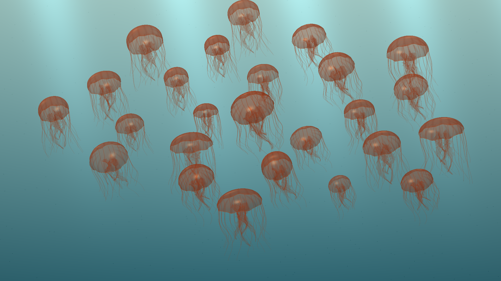

# Native gallery

These images come from the running 1.1 candidate on the Google TV ARM64 API34 emulator at 1920x1080. They show the original GLES2 renderer. Final candidate provenance and physical-device status are recorded in [verification](VERIFICATION.md).

<table>
<tr><td></td><td></td><td></td></tr>
<tr><td></td><td></td><td></td></tr>
</table>
