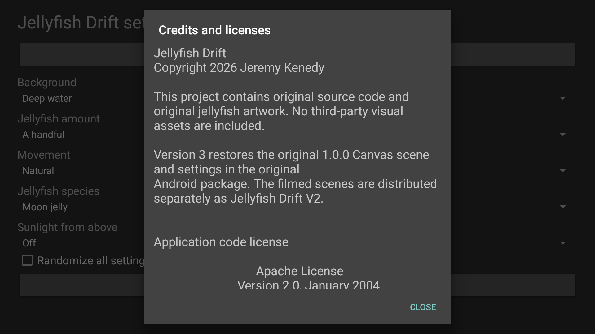
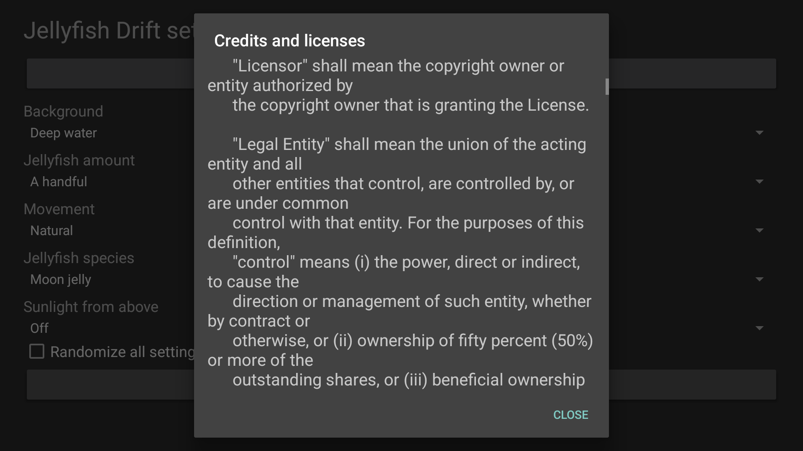

# Screenshots

Current 3.0.0/code5 native captures, Android TV API 34 emulator, 1920 x 1080, captured October 22, 2026 (Pacific). These show Settings and Preview. Actual bound Dream and physical device checks for this split package remain pending.

<table>
<tr><td width="33%"> Deep water, original moon-jelly artwork</td><td width="33%"> Sunlit water, original sea-nettle artwork</td><td width="33%"> Six original settings</td></tr>
<tr><td width="33%"> Offline attribution</td><td width="33%"> Scrollable Apache license</td></tr>
</table>

[Capture provenance and image hashes](../art/screenshots/sources.json) identify the exact candidate. No older-package image is presented as a capture of this candidate.

The classic artwork and Canvas presentation come from the original public v1.0.0 source.
