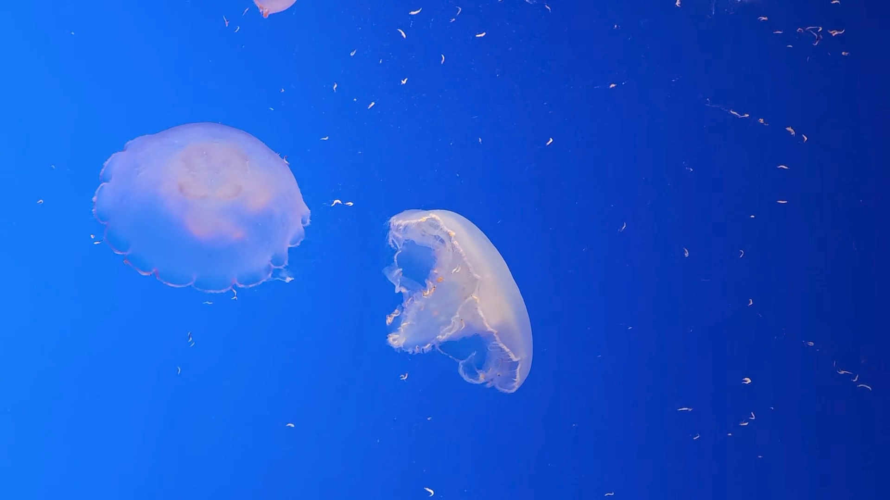
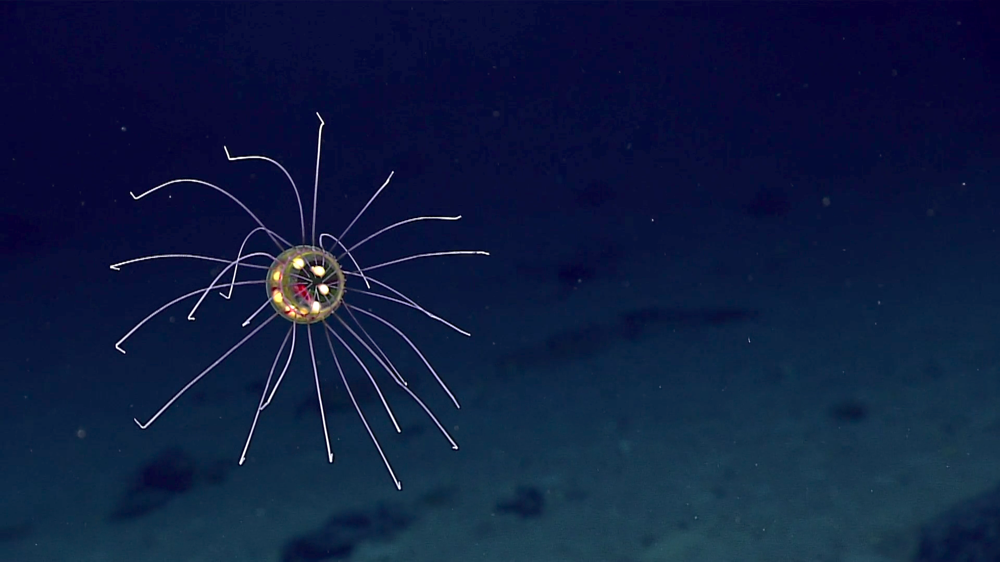
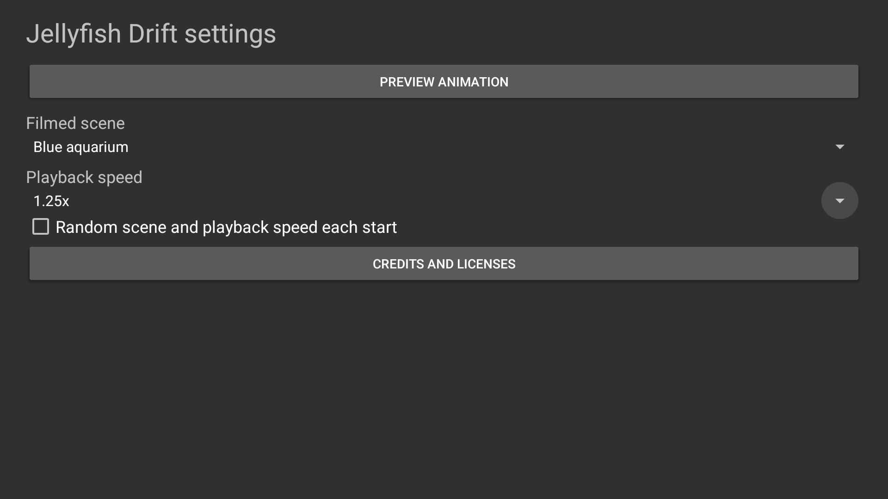
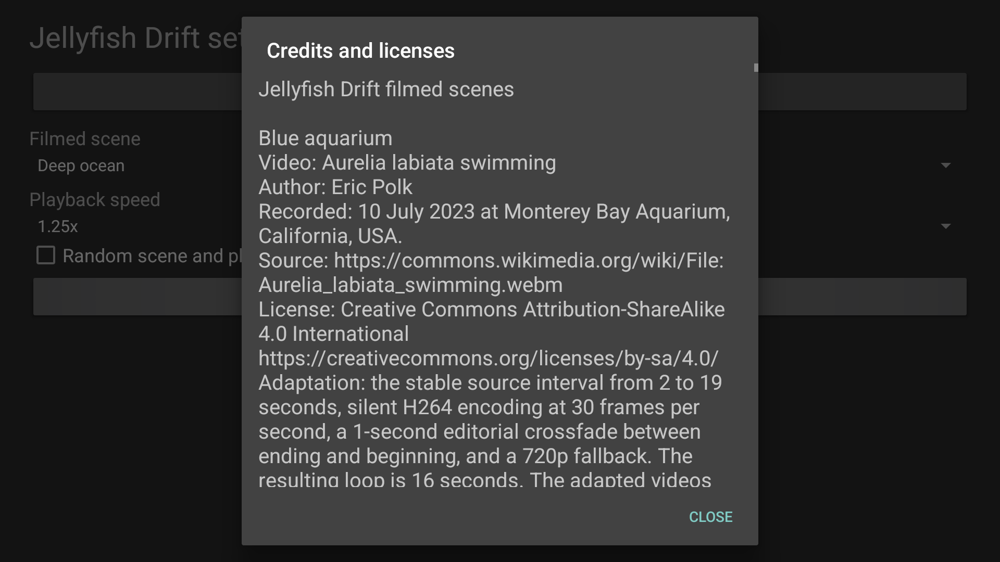
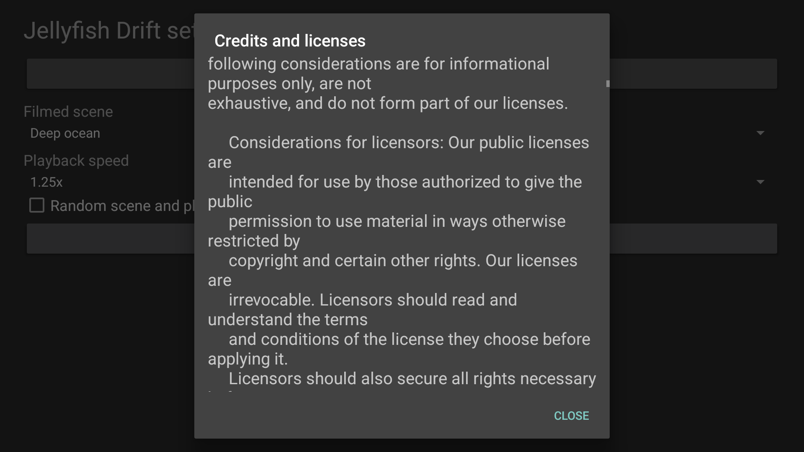
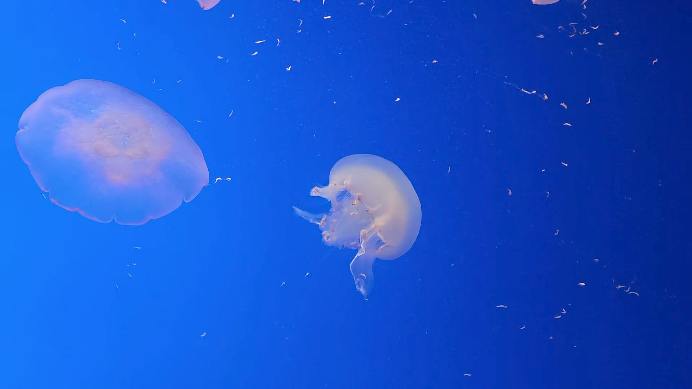
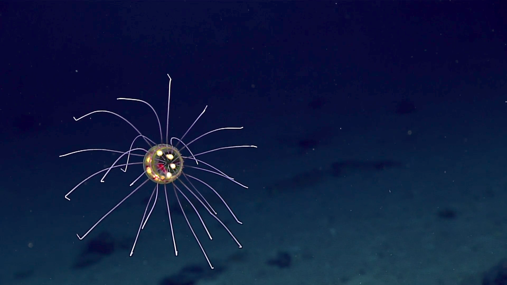
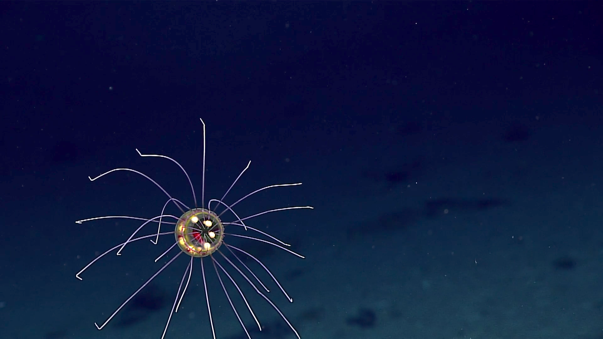
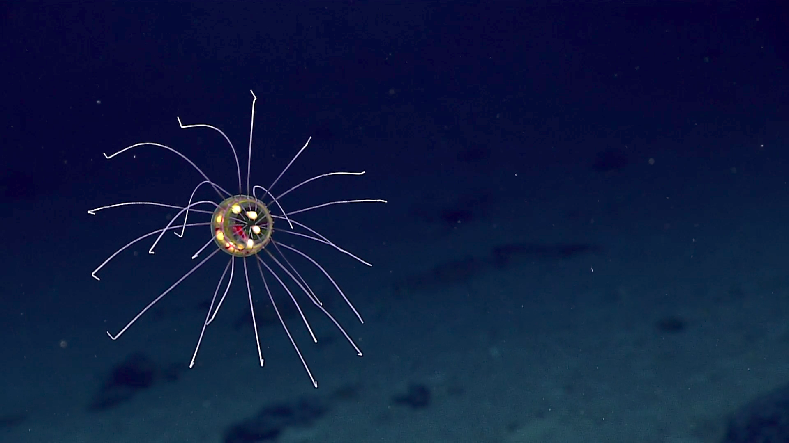

# Screenshots

All images below are actual native captures of Jellyfish Drift 2.0.0, code 3, on an Android TV API 34 emulator. The APK SHA-256 is `0843b6b2005667d2ddec910bd2a25c9b3000111864369c1175650ae4774d77e9`. They do not establish physical TV performance or 4K source resolution. Final physical production Dream validation remains pending.

<table>
<tr><td></td><td></td><td></td></tr>
<tr><td>Blue aquarium at recorded speed</td><td>Deep ocean at recorded speed</td><td>Settings after actual D-pad selection</td></tr>
<tr><td></td><td></td><td></td></tr>
<tr><td>Credits outside the scene</td><td>Scrollable full license text</td><td>Blue aquarium at 1.25x</td></tr>
<tr><td></td><td></td><td></td></tr>
<tr><td>Deep ocean at 0.9x</td><td>Deep ocean at 1.25x</td><td>Playback resumed after Home</td></tr>
</table>

Capture dates, hashes, platform, and exact candidate are recorded in [capture provenance](../art/screenshots/sources.json). Blue aquarium images remain CC BY-SA 4.0, with credit to Eric Polk. Deep ocean images derive from credited NOAA Ocean Exploration footage. Full attribution, edits, and limitations are in the [media notices](../assets/NOTICE.txt).

The 16-second and approximately 19-second loops use editorial dissolves. Crossota's source also transitions between camera views. Stills cannot establish smooth motion; moving review and presentation measurements are recorded separately in [verification](VERIFICATION.md).
