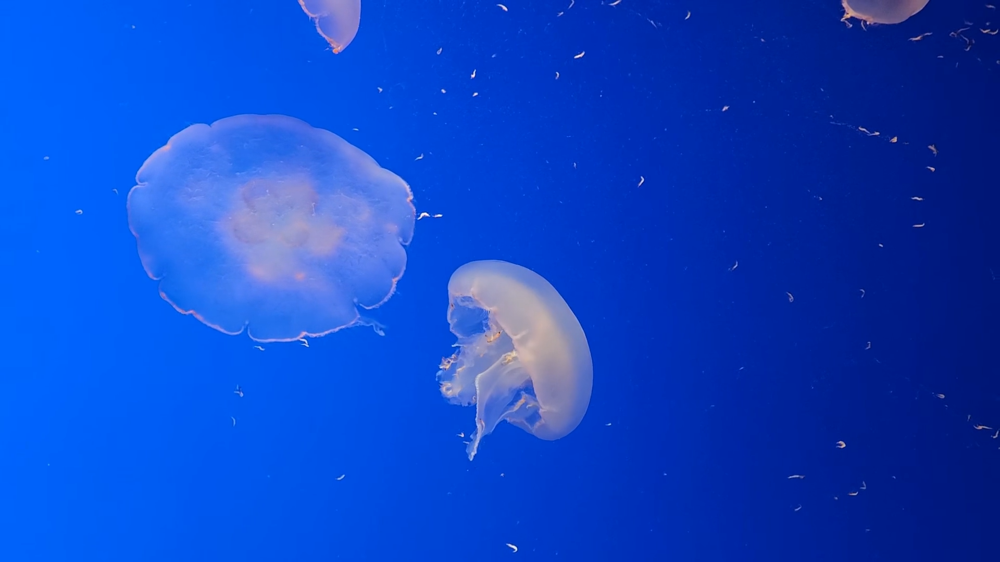
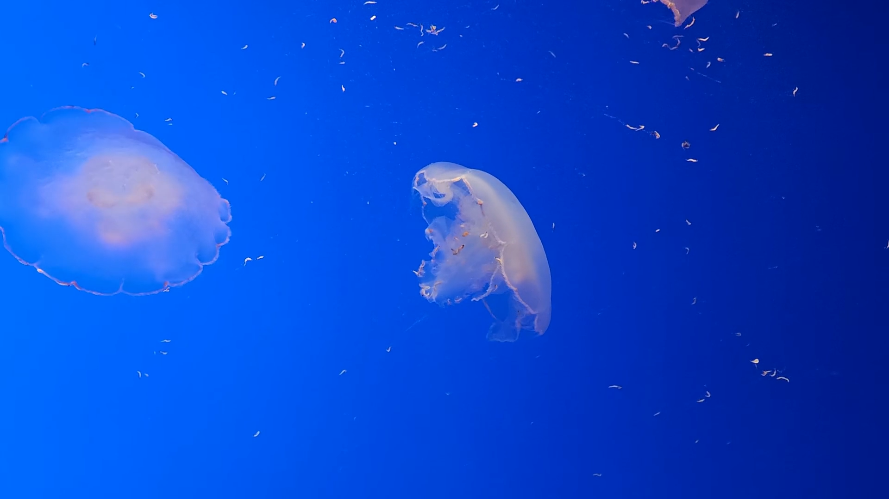
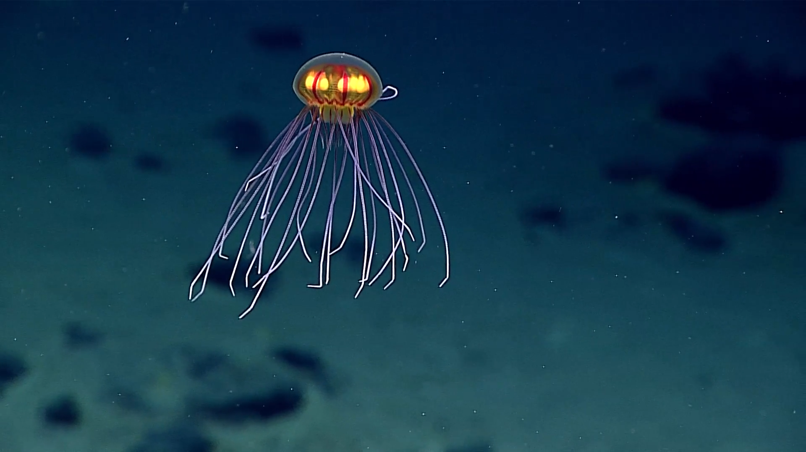

# Screenshots

## Physical Fire TV, code 4

These are actual 1920x1080 captures from the signed 2.0.0/code 4 candidate, APK SHA-256 `109099f558be22a71970b56a962907053dd3b19cd6bc95b32a03101da62f0c8e`, running as the selected non-test Dream on Fire TV API 30. Each scene settled for 40 seconds before presentation sampling and capture. Stills do not establish pacing or motion; see [device verification](VERIFICATION.md).

<table>
<tr><td></td><td></td><td></td></tr>
<tr><td>Blue aquarium at 0.9x</td><td>Blue aquarium at 1.25x</td><td>Deep ocean at 0.9x</td></tr>
</table>

[Deep ocean at 1.25x: full physical capture](../art/screenshots/deep-fast-physical.png).

## Android TV settings, code 4

These actual 1920x1080 Android TV API 34 captures use the same signed code 4 APK. D-pad navigation opened and scrolled Credits. The explicit Close button was activated by a native tap; D-pad navigation to Close is not claimed.

<table>
<tr><td></td><td></td><td></td></tr>
<tr><td>Scene and playback controls</td><td>Credits outside the scene</td><td>Scrollable full license text</td></tr>
</table>

Capture dates, hashes, platform, and exact candidate are recorded in [capture provenance](../art/screenshots/sources.json). Blue aquarium images remain CC BY-SA 4.0, with credit to Eric Polk. Deep ocean images derive from credited NOAA Ocean Exploration footage. Full attribution, edits, and limitations are in the [media notices](../assets/NOTICE.txt).

The 16-second and approximately 19-second loops use editorial dissolves. Crossota's source also transitions between camera views. Stills cannot establish smooth motion; moving review and presentation measurements are recorded separately in [verification](VERIFICATION.md).
