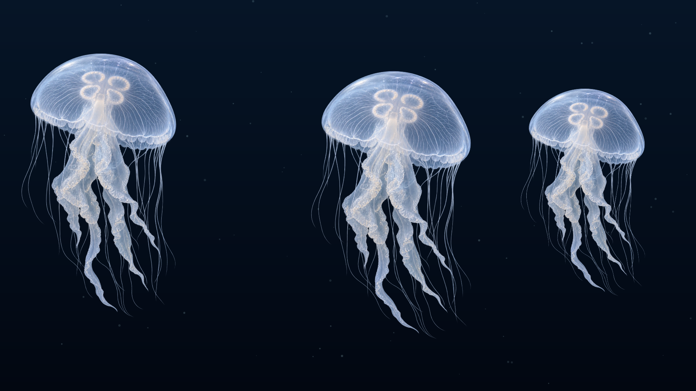
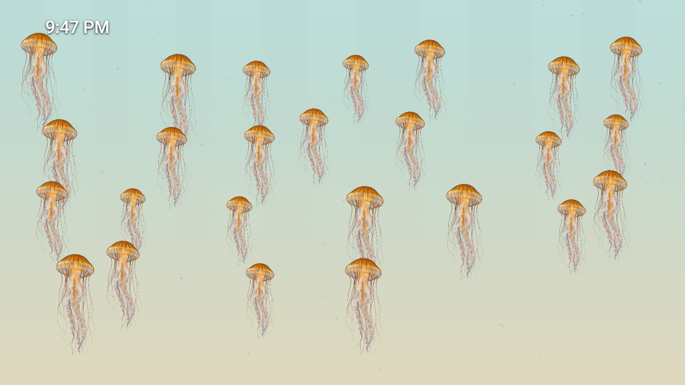
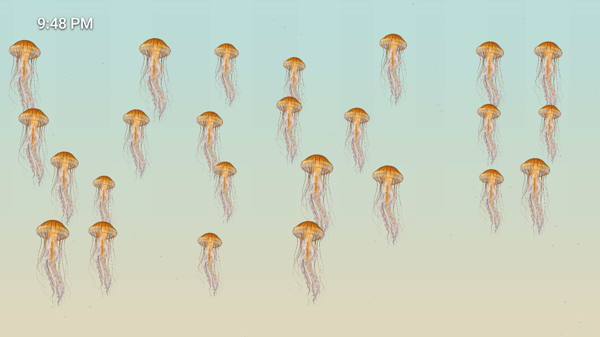
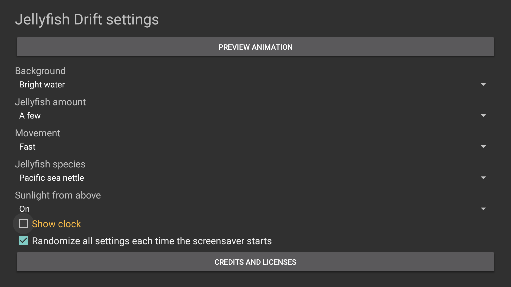
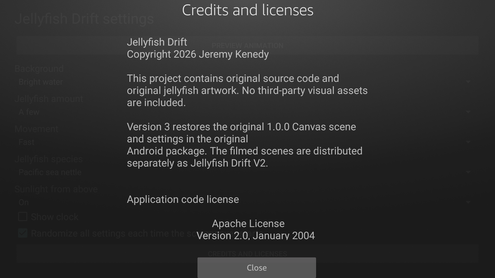
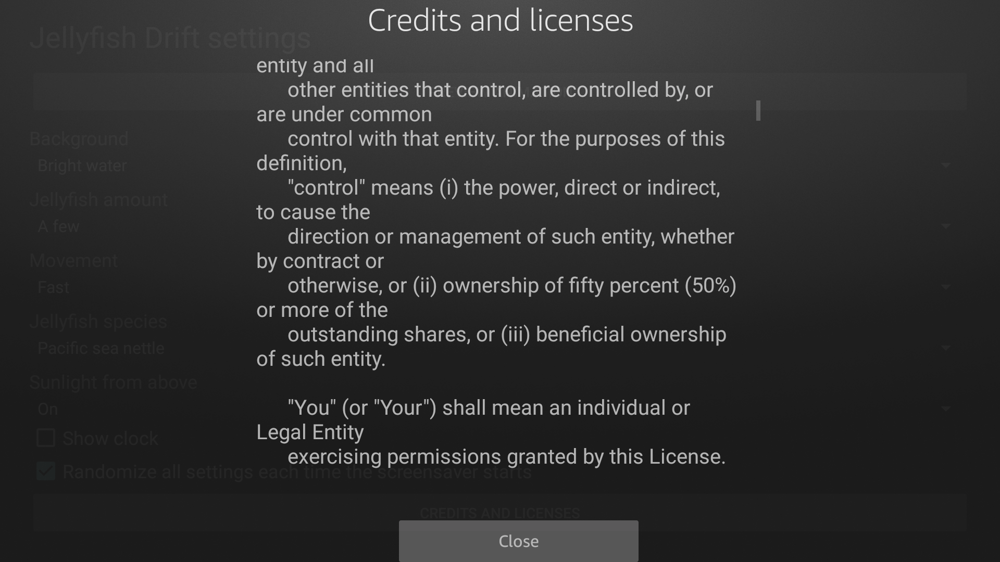
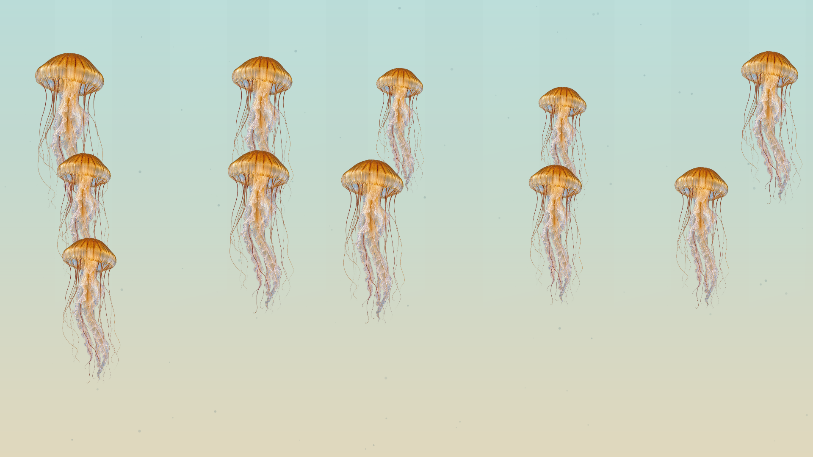
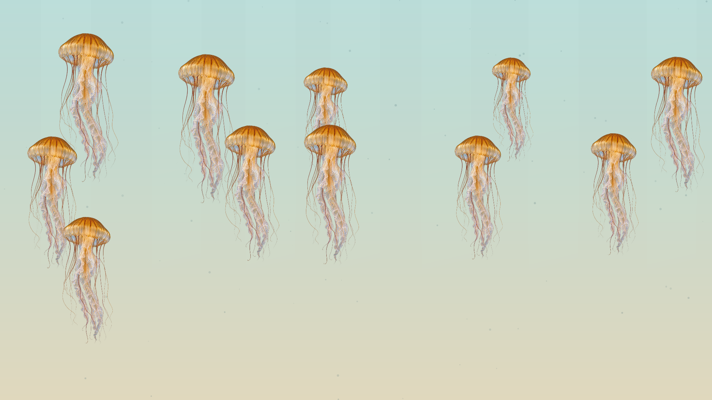

# Screenshots

Current 3.0.0/code7 captures from a physical Fire TV AFTDEC012E/API 30 at 1920 x 1080, October 22, 2026 (Pacific). The first row shows actual bound non-test Dreams: dark/few/moon/slow with clock off, then bright/schools/nettle/fast/rays with clock on at early and later times. Settings, licenses, and Preview remain outside the Dream.

<table>
<tr><td width="33%"> Dark water, three moon jellyfish, clock off</td><td width="33%"> Bright water, schools, clock on</td><td width="33%"> Same Dream with later clock position</td></tr>
<tr><td width="33%"> Native settings with Show clock focused</td><td width="33%"> Offline Credits</td><td width="33%"> Scrolled Apache license</td></tr>
<tr><td width="33%"> Native Preview before Home</td><td width="33%"> Native Preview resumed after Home</td></tr>
</table>

[Image provenance and SHA-256 hashes](../art/screenshots/sources.json) identify the exact candidate. See the [verification scope](VERIFICATION.md) for native controls, task navigation, and sampled presentation results. These are the original illustrated scene, not filmed animals.
