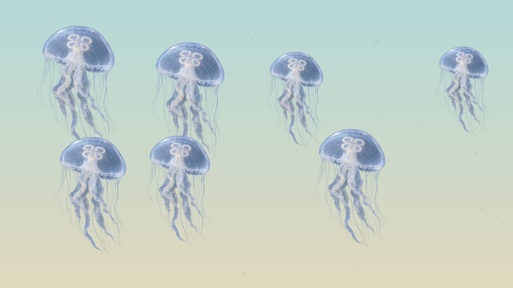
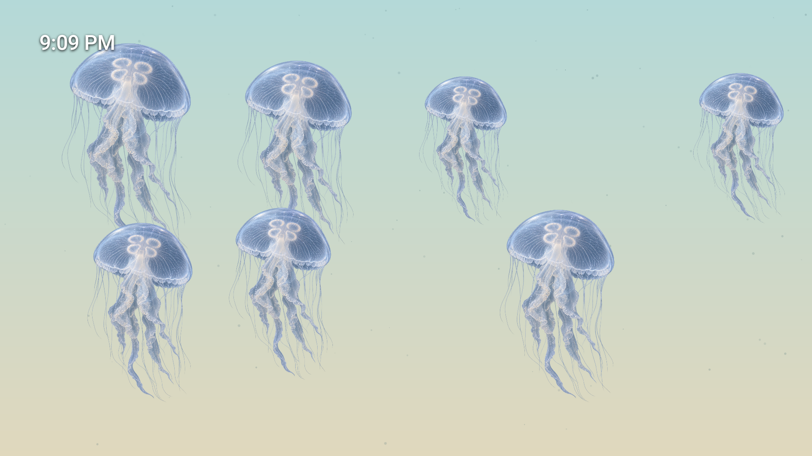
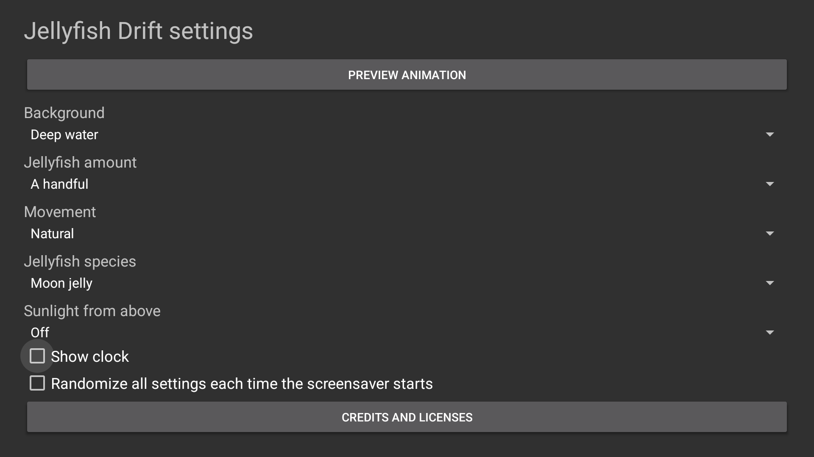
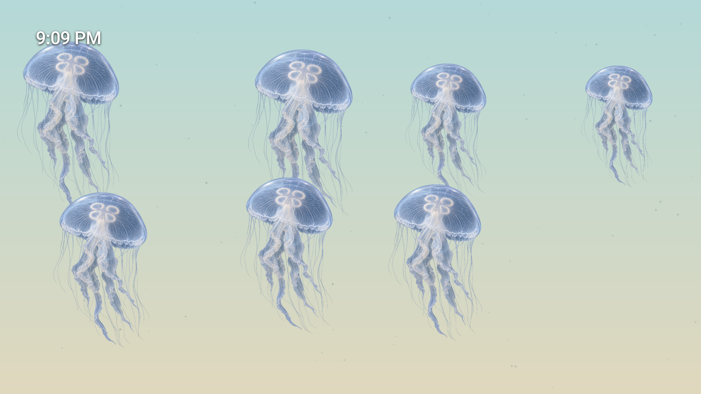
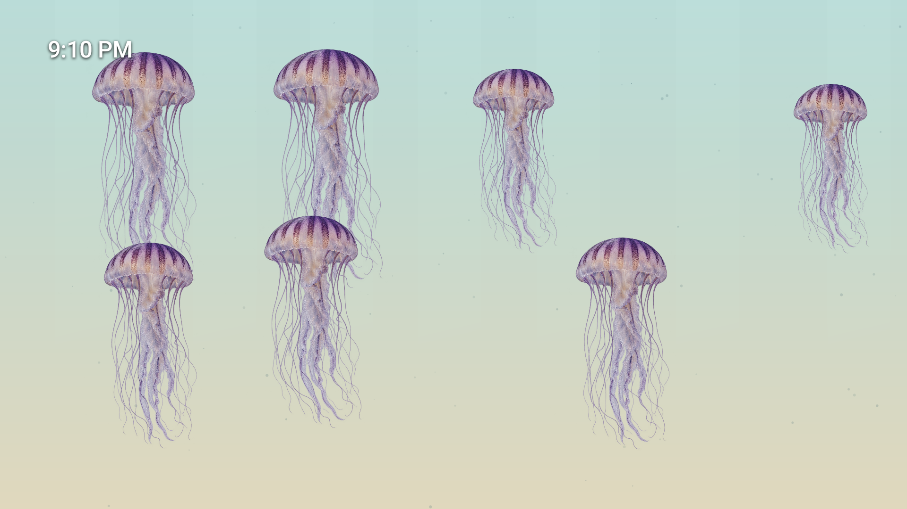
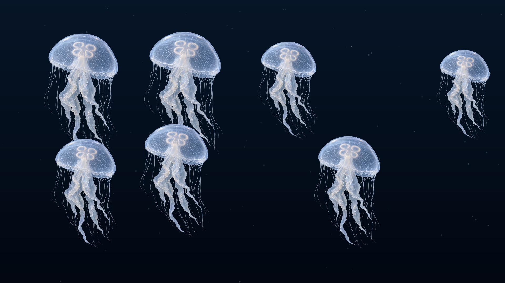
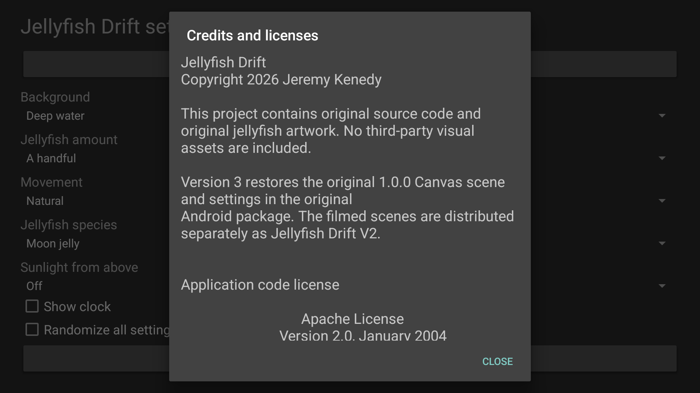
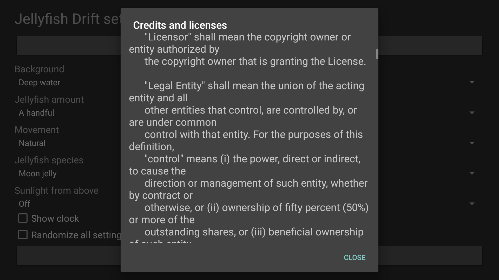

# Screenshots

Current 3.0.0/code6 native captures from an Android TV API 34 emulator at 1920 x 1080, October 22, 2026 (Pacific). These show Settings and Preview, not an actual bound Dream or physical performance proof.

<table>
<tr><td width="33%"> Clock off</td><td width="33%"> Clock on</td><td width="33%"> Native settings</td></tr>
<tr><td width="33%"> Clock after 20 seconds of drift</td><td width="33%"> Clock on with randomized scene</td><td width="33%"> Clock off with randomized scene</td></tr>
<tr><td width="33%"> Offline credits</td><td width="33%"> Scrollable licenses</td></tr>
</table>

[Image provenance and SHA-256 hashes](../art/screenshots/sources.json) identify the exact candidate. Clock on/off is selected with the native remote control. The paired clock images are 20 seconds apart; the clock keeps its saved choice during scene randomization.

The classic Canvas scene and artwork are restored from public v1.0.0. The optional clock is a separate overlay.
